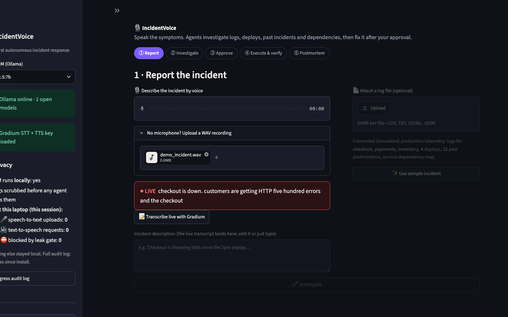
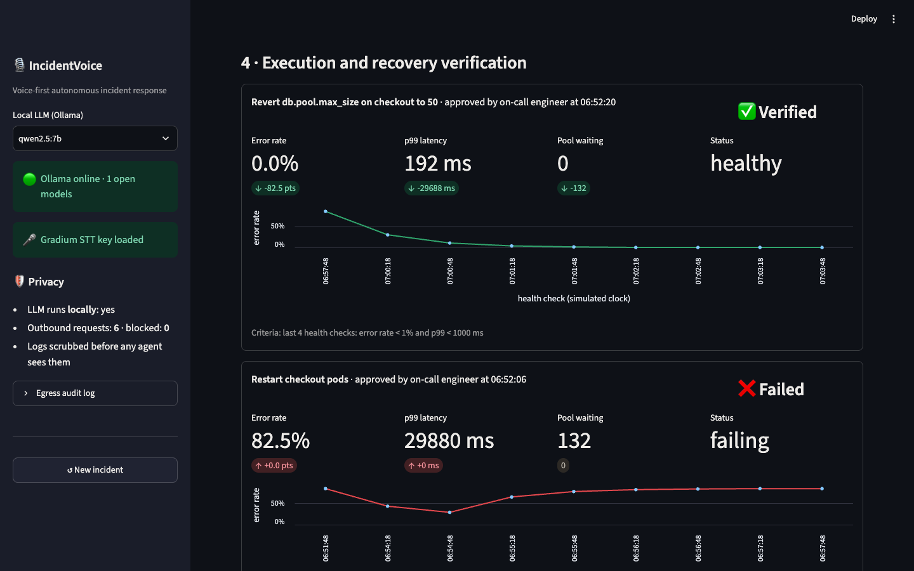
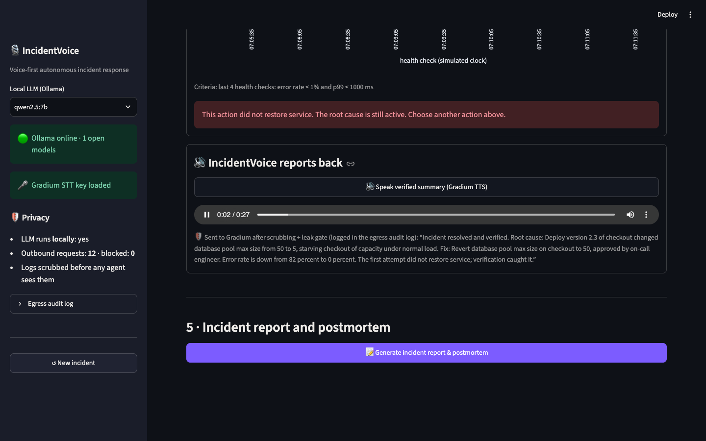

# 🎙️ IncidentVoice -  AI-powered, voice-first IT incident management and autonomous root-cause analysis platform

**Speak the symptoms. Agents find the root cause and fix it after you approve.**

IncidentVoice is a voice-first, privacy-first incident response prototype. An on-call engineer
describes a production incident out loud, with an optional log file. A team of AI agents then
investigates logs, deploy history, past postmortems and service dependencies, ranks probable
root causes with evidence, and recommends a fix. After explicit human approval, it executes
the fix in a simulated production environment, verifies recovery with health checks, **speaks
the verified summary back** (Gradium text-to-speech), and writes the postmortem.

Everything except Gradium's voice in and voice out runs on the laptop: open-source LLMs via
Ollama, local BM25 retrieval, and regex PII scrubbing. The two outbound calls (incident audio to
Gradium STT, scrubbed summary text to Gradium TTS) both go through a leak gate and an audit log.

**By the numbers:** 158/158 planted secrets removed (100% recall per type, 0 false positives) ·
correct root cause ranked #1 (~66% confidence) · diagnosis in 25–35 s on a laptop · wrong fix caught by
verification, right fix verified (error rate 82% → 0%) · 23 tests, fully offline.


| Voice in: live transcript (Gradium STT) | Wrong fix caught, right fix verified | Voice out: spoken summary (Gradium TTS) |
|---|---|---|
|  |  |  |

## Quick start

```bash
git clone https://github.com/MyclineShareena/HACK1984.git && cd HACK1984
ollama pull qwen2.5:7b             # once; any Ollama model works (llama3.2:3b is faster)
cp .env.example .env               # then put your Gradium key in .env (optional: voice in + out)
./run.sh                           # creates .venv, installs deps, serves http://localhost:8501
```

Keys and the model live in `.env` (git-ignored, created from `.env.example` on first run), so
nothing has to be typed into the terminal. A variable you `export` in the terminal still wins
over `.env`, and the sidebar shows which one the app is using.

Manual equivalent:

```bash
python3 -m venv .venv && .venv/bin/pip install -r requirements.txt
.venv/bin/python generate_data.py  # builds data/logs (also done automatically on first run)
.venv/bin/streamlit run app.py
```

Then open http://localhost:8501 in your browser.

Requirements: Python 3.10+ (developed on 3.14) and [Ollama](https://ollama.com) running locally.

### Demo in 60 seconds
1. Press the 🎙️ recorder, describe the incident out loud, stop, then press **📝 Transcribe live
   with Gradium**. You can also type the description or attach a `.log` file, or click
   **✨ Use sample incident**. For a repeatable demo (noisy room, automated capture), upload
   `docs/demo_incident.wav`, a spoken incident made with macOS `say`, under "Or upload a WAV
   recording" instead of using the microphone.
2. Click **🚀 Investigate**. Watch the agent trace stream in (about 30 s with `qwen2.5:7b`).
3. Review the findings: error timeline with the deploy marker, the suspicious config diff,
   similar past incidents, the blast-radius graph, and ranked hypotheses with evidence.
4. Optional, to show safety: pick **Restart checkout pods**, tick approval, execute. Health
   checks show the errors return, so the result is **❌ not verified**.
5. Pick the **⭐ RECOMMENDED** fix (revert `db.pool.max_size` to 50), approve, execute. You
   get **✅ Verified**.
6. Click **🔊 Speak verified summary**: Gradium reads the outcome aloud (the exact text sent
   is shown and audited).
7. Click **📝 Generate incident report & postmortem**, then download the Markdown.

## How it works

```
 voice ──► Gradium STT (wss, gated + audited) ──► transcript ─┐
 typed text / uploaded log ───────────────────────────────────┤
                                                              ▼
                                    🛡️ Privacy layer: scrub PII/secrets
                                                              ▼
 🧭 Triage agent (LLM): severity, category, affected service
 📈 Log analyst: error timeline, onset, signatures, latency, observed config values
      ├─ 🚀 Deploy analyst: deploys before onset, config diffs, value/keyword evidence ┐
      ├─ 🕸️ Dependency analyst: health of deps, blast radius, graph                     ├ parallel
      └─ 📚 History agent (RAG): BM25 over postmortems                                 ┘
 🎯 Root-cause agent (LLM + evidence scores): ranked hypotheses, explanations
 🛠️ Remediation: action catalog + guardrail (must address top cause) ──► 👤 HUMAN APPROVAL
 ⚙️ Simulated prod executes action ──► 🩺 8 health checks ──► verify (or try another action)
 🔊 Talk-back: spoken summary ──► 🛡️ scrub + leak gate ──► Gradium TTS ──► audio (audited)
 📝 Postmortem agent (LLM): Markdown report with timeline, evidence, verification, follow-ups
```

**Design choices that matter for judging**
- **Evidence first, LLM second.** Agents compute facts deterministically: onset time,
  config diffs, value matches such as `pool.max=5` in the error events, and BM25 hits. The
  LLM ranks the hypotheses and explains them. The final confidence blends both, and every
  LLM output is schema-constrained and validated.
- **Guardrails.** The LLM can only pick actions from a catalog, and the action must address
  the top-ranked cause. Otherwise it is overridden, and the override is shown in the UI.
- **Verification is real.** The simulator's physics don't depend on the diagnosis. Restart
  gives only brief relief and scale-out only partial relief; reverting the wrong key does
  nothing. Only the real fix passes the health checks.
- **Human approval.** Nothing executes without a named approver ticking the checkbox.
  Approvals and rejections both go into the report timeline. Each try is labelled
  ("Attempt 1 ❌ not verified", "Attempt 2 ✅ verified"); once the real fix passes, failed
  attempts collapse but stay in the record.
- **Voice in and voice out.** Gradium STT turns the engineer's description into a live
  transcript; after verification, Gradium TTS speaks the summary back. Both directions pass
  the same leak gate and audit log.
- **Privacy.** Logs are scrubbed on load. The LLM runs on localhost, Streamlit telemetry is
  off, and the server binds to localhost only. Only voice data leaves the laptop: incident
  audio (logged with size and sha256) and the scrubbed spoken summary (logged verbatim), both
  in `egress_log.jsonl`. The sidebar counts them per session ("🎤 speech-to-text uploads: 1 ·
  🔊 text-to-speech requests: 1 · ⛔ blocked: 0"), so judges can see exactly what left.

## Project layout

```
HACK1984/
  app.py                  Streamlit UI (5-step flow)
  run.sh                  one-command start
  .streamlit/config.toml  dark theme, telemetry off, localhost-only, minimal toolbar
  .env.example            config template; copy to .env (git-ignored) for your key and model
  engine/
    stt.py                Gradium streaming STT (websocket, 24 kHz PCM, live partials)
    tts.py                Gradium TTS talk-back (websocket, 48 kHz PCM → WAV), egress-gated
    env.py                tiny stdlib .env loader (terminal variables take precedence)
    llm.py                Ollama client, JSON-schema output, egress-gated if remote
    data.py               log parsing (JSON lines or plain text), scrubbing, analysis
    agents.py             triage, logs, deploys, dependencies, history, root cause, actions
    orchestrator.py       runs the agents (parallel stage) and records the trace
    simulator.py          simulated prod: execute actions, health checks, verify
    report.py             postmortem generator
  privacy_layer/          stdlib-only: scrubber, egress gate, BM25 incident search
  data/                   synthetic scenario (seed 1984): deploys, services, 15 postmortems;
                          logs/ + planted_secrets.json are generated on first run (they hold FAKE
                          secrets for the scrubber tests, so they're kept out of git)
  tests/                  23 tests (scrubber recall, egress gate, search, offline engine, talk-back, .env)
  scripts/capture_demo.py headless-Chrome walkthrough → docs/screenshots + docs/*.gif
  docs/                   SUBMISSION.md (write-up, slide numbers, video script), screenshots,
                          demo GIF, sample_postmortem.md, demo_incident.wav (spoken test input)
  demo_scrub.py           privacy demo for judges (raw vs scrubbed lines + leak gate)
```

## Configuration

Set these in `.env` (see `.env.example`), or export them in the terminal, which overrides `.env`.
Restart the app after changing `.env`.

| Variable | Default | Meaning |
|---|---|---|
| `GRADIUM_API_KEY` | (unset) | Enables voice input and spoken summaries |
| `GRADIUM_STT_URL` | `wss://api.gradium.ai/api/speech/asr` | e.g. the EU endpoint `wss://eu.api.gradium.ai/api/speech/asr` |
| `GRADIUM_TTS_URL` | `wss://api.gradium.ai/api/speech/tts` | TTS endpoint |
| `GRADIUM_VOICE_ID` | `YTpq7expH9539ERJ` | TTS voice ("Emma" from Gradium's docs) |
| `GRADIUM_PACE` | `0.25` | Audio send pacing (0.25 = 4x real time; lower = faster) |
| `OLLAMA_HOST` | `http://localhost:11434` | A remote host is allowed but goes through the leak gate |
| `INCIDENTVOICE_MODEL` | `qwen2.5:7b` | Default model (a sidebar picker appears once more than one model is pulled) |
| `INCIDENTVOICE_EGRESS_LOG` | `egress_log.jsonl` in the project folder | Audit log path |

## Privacy layer API (for the agent flow)

```python
from privacy_layer import scrub, log_egress, search_incidents, EgressBlocked, read_log, summarize
clean, counts = scrub(text)                 # [EMAIL] [IP] [CARD] [API_KEY] [TOKEN] [PHONE]
safe = log_egress("gradium", payload)       # scrub + leak gate + audit log; send `safe`
summarize(read_log())                       # {"stt": 1, "tts": 1, "other": 0, "blocked": 0}
hits = search_incidents("pool exhausted after deploy", k=3)
```

- 158/158 planted secrets removed (100% recall per type, 0 false positives on these logs).
- `python demo_scrub.py` shows raw vs scrubbed lines. `python -m privacy_layer.egress` prints
  the audit log.

## Team

Built by **Tensor Titans** for HACK1984, a privacy-first hackathon.

| Collaborator | GitHub |
|---|---|
| Mycline Shareena | [@MyclineShareena](https://github.com/MyclineShareena) |
| Sanika Girase | [@sanikagirase](https://github.com/sanikagirase) |

- Repository: [MyclineShareena/HACK1984](https://github.com/MyclineShareena/HACK1984)
